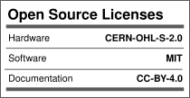

# MAKER'S ASYLUM INNOVATION SCHOOL
## 2026 Winter Diwali COHORT #8 Team 2
## BCI Gaming
Brain control device that can be used to map game controls

## EqualCare patient-assistance prototype

The current software prototype implements patient requests and nurse
acknowledgement/resolution over local Wi-Fi. Game/OLED work is outside this scope.

- [Team setup and integration guide](Documentation/INTEGRATION.md)
- [Versioned OpenAPI contract](Documentation/openapi.json)
- [Hardware wiring handoff](Documentation/WIRING_HANDOFF.md)
- Backend: `Code/backend/`; replaceable dashboards: `Code/frontend/`;
  ESP32 transport adapter: `Code/firmware/`.

Windows quick start: run `Code/backend/start.ps1`. The first run provisions local
credentials. Open `http://localhost:8000` on the host laptop. See the integration
guide for the second laptop, firmware configuration, simulators, and tests.

## STRUCTURE
1. **CAD/**
   - CAD design files
   - e.g., `final_design.FCStd`, `step_file.STEP`

2. **Code/**
   - Arduino, Python, or other code files
   - e.g., `arduino_code.ino`, `motor_control.py`

3. **Documentation/**
   - Presentation slides, PDF reports, BoM
   - e.g., `project_presentation.pptx`, `BOM.xlsx`

4. **Electronics/**
   - Circuit schematics or PCB layout images
   - e.g., `schematic_diagram.jpg`

5. **Photos_Videos/**
   - Images and videos
   - e.g., `demo_video.mp4`, `prototype_photo.jpg`
   - **Rename all photos and videos in sequential order, appending `TEAMNUMBER_PROJECT_NAME` to each asset.**

6. **Reference_Data/**
   - Downloaded data such as catalogs, data sheets, pinout diagrams, etc.
   - e.g., `demo_video.mp4`, `prototype_photo.jpg`

7. **WIKI**
   - For more information about the project, check out our wiki

## License

Licenses

#### Hardware
CERN Open Hardware License Version 2 - Strongly Reciprocal ([CERN-OHL-S-2.0](https://spdx.org/licenses/CERN-OHL-S-2.0.html)).

#### Software
MIT open source [license](http://opensource.org/licenses/MIT).

#### Documentation:
 This work is licensed under a <a rel="license" href="http://creativecommons.org/licenses/by/4.0/">Creative Commons Attribution 4.0 International License</a>.

---

## 📬 Contact/Team

> _List team members and contact emails or GitHub profiles._
[@anool](https://github.com/Anool)
> 
>
> ---
